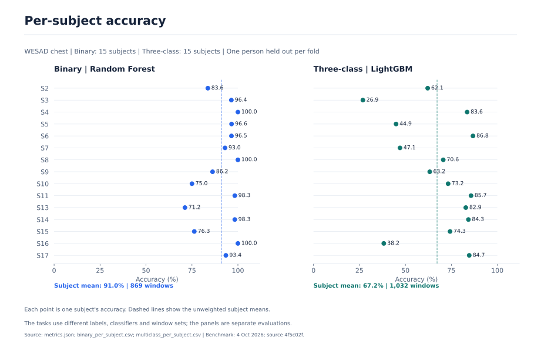
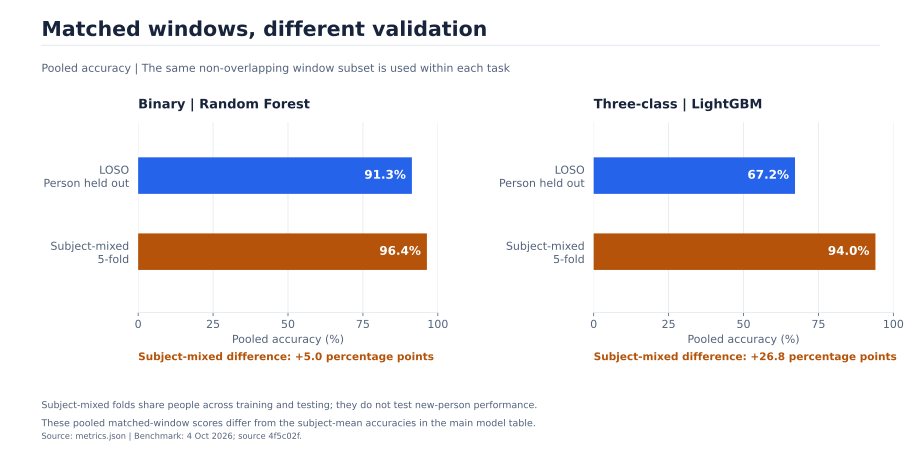
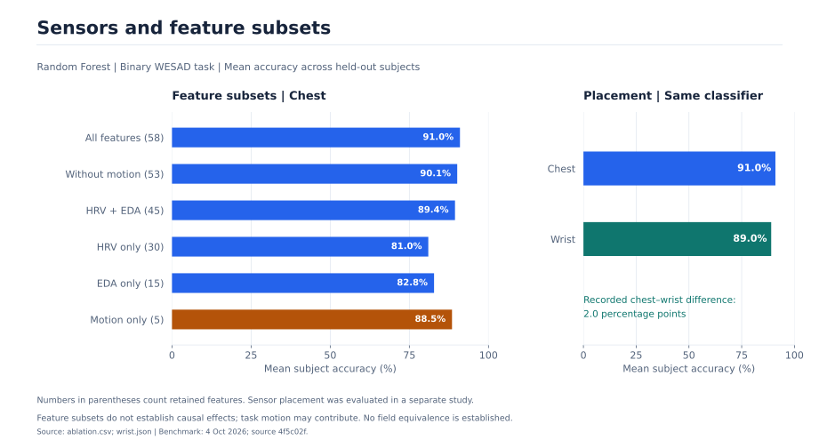
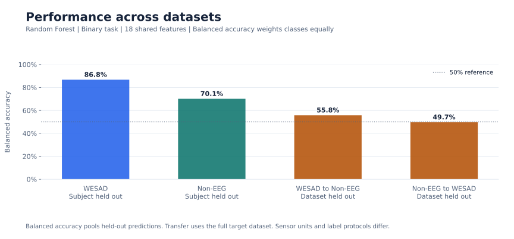
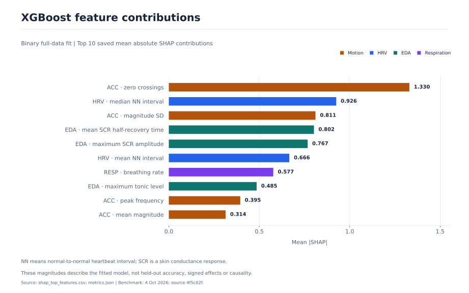
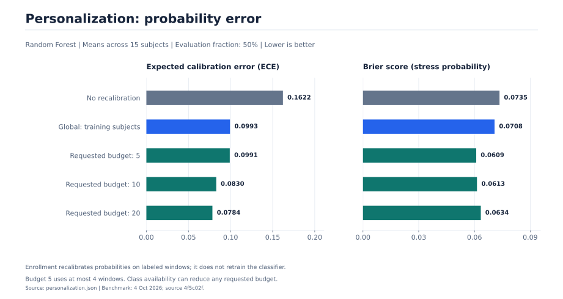

# CalmSense

CalmSense tests whether wearable signals can distinguish stress from baseline in people held out from training. It compares four feature classifiers and a 1D CNN on WESAD chest recordings; the three-class task adds amusement. The dashboard displays saved experiments and recorded signal clips.

**Keywords:** Python · NumPy · scikit-learn · PyTorch

## Pipeline

[](docs/assets/pipeline.svg)

[Full-size diagram](docs/assets/pipeline.svg) · [Edit in Figma](https://www.figma.com/design/tfPEQsLyRoAj9yT3HrPaob?node-id=9-2)

### Signals and models

| Stage | Processing |
| :-- | :-- |
| Recorded signals | WESAD chest ECG, skin conductance (EDA), temperature, respiration, and three-axis acceleration, recorded at 700 Hz. |
| Windows | Filter signals; form 60-second windows with a 30-second step. Keep windows with at least 90% labels from one eligible class. |
| Feature models | Extract HRV, EDA, respiration, temperature, and motion summaries. Compare Logistic Regression, Random Forest, XGBoost, and LightGBM. The saved run uses 58 of 60 registered features; two respiration features are entirely missing. |
| 1D CNN | Resample five processed channels to 1,024 samples each: ECG, EDA, temperature, respiration, and acceleration magnitude. |
| Held-out testing | Hold out one complete person in each of 15 folds. Fit imputation and scaling on training people only. CNN validation uses separate training-pool subjects; normalization uses inner training windows only. |

### Dashboard demo

[](https://urmeo.github.io/calm-sense/)

[](frontend/public/media/dashboard-tour.mp4?raw=true)

The dashboard displays recorded outputs without live inference. Signal clips are downsampled and concatenated; displayed time is not one continuous recording.

## Results

These are the saved **4 October 2026** results. They predate several preprocessing and enrollment-sampling fixes; current-code performance has not been re-established.

| WESAD subjects | Saved chest features | Binary windows | Three-class windows |
| :--: | :--: | :--: | :--: |
| 15 | 58 | 869 | 1,032 |

### Unseen-person classification

Accuracy and macro-F1 average held-out subjects. Binary AUROC and AUPRC pool held-out predictions.

| Model | Binary accuracy | Binary macro-F1 | Binary AUROC | Binary AUPRC | Three-class accuracy | Three-class macro-F1 |
| :-- | --: | --: | --: | --: | --: | --: |
| Random Forest | 91.0% | 0.895 | 0.973 | 0.959 | 65.1% | 0.542 |
| XGBoost | 90.8% | 0.881 | 0.973 | 0.957 | 64.2% | 0.562 |
| Logistic Regression | 91.0% | 0.893 | 0.963 | 0.953 | 65.9% | 0.603 |
| LightGBM | 88.9% | 0.855 | 0.964 | 0.944 | 67.2% | 0.590 |
| 1D-CNN | 73.3% | 0.654 | Not computed | Not computed | 49.9% | 0.401 |




### Validation and ROC curves

The matched comparison uses the same non-overlapping windows under LOSO and subject-mixed validation. Subject-mixed accuracy does not measure performance on unseen people.




### Sensors and cross-dataset transfer

These separate studies test feature subsets, chest versus wrist placement, and transfer using 18 shared WESAD wrist/PhysioNet Non-EEG features. Devices, units, stressors, and labels differ.





### Feature contributions

SHAP describes a full-data binary XGBoost fit. The ranking does not measure held-out performance or causal effects.



### Calibration and personalization

Recalibration changes probabilities while keeping the classifier fixed. Calibration and personalization use different splits and aggregation methods.




<details>
<summary>Calibration and personalization tables</summary>

RF calibration uses 15 confidence bins. Isotonic calibration uses training-subject out-of-fold probabilities. ECE weights absolute confidence–accuracy gaps by bin count; MCE takes the largest. Brier is stress-probability mean squared error.

<!-- AUTOGEN:calibration START -->
| Evaluation | ECE | MCE | Brier |
| --- | :-: | :-: | :-: |
| Subject-mixed 5-fold, non-overlapping | 0.087 | 0.252 | 0.038 |
| LOSO, matched non-overlapping | 0.090 | 0.363 | 0.073 |
| LOSO, all windows | 0.077 | 0.177 | 0.069 |
| LOSO, all windows + isotonic | 0.026 | 0.350 | 0.064 |
<!-- AUTOGEN:calibration END -->

Calibration metrics pool predictions; matched rows share non-overlapping windows. Personalization averages subjects on a separate, non-overlapping evaluation half. Labeled enrollment windows recalibrate probabilities without retraining the classifier.

<!-- AUTOGEN:personalization START -->
| Recalibration / requested enrollment budget | ECE | Brier |
| --- | :-: | :-: |
| None (LOSO) | 0.162 | 0.073 |
| Global (training subjects) | 0.099 | 0.071 |
| Per-subject, budget 5 | 0.099 | 0.061 |
| Per-subject, budget 10 | 0.083 | 0.061 |
| Per-subject, budget 20 | 0.078 | 0.063 |
<!-- AUTOGEN:personalization END -->

Budget 5 uses at most 4 class-balanced windows; class availability can reduce any request. Saved results predate the enrollment-sampler fix.

</details>

<a id="evaluation"></a>

<details>
<summary>Evaluation notes</summary>

| Item | Method and scope |
| :-- | :-- |
| Saved run | 4 October 2026, source `4f5c02f`. Scores predate RR correction, wrist EDA, SCR detection, filter-order, and enrollment-sampling fixes. ROC replay on 12 October 2026 (Asia/Dhaka) used that source and verified cached features, matching the original AUROC/AUPRC. [Provenance](outputs/results/provenance.json) · [ROC records](outputs/results/roc_curves.json). |
| Inputs | 60-second windows, 30-second step, at least 90% labels from one eligible class. Feature models use 58 of 60 registered features; two respiration features are entirely missing. CNN input: five processed channels, 1,024 samples each. |
| Validation | Each of 15 LOSO folds holds out one person. Imputation and scaling use training people only. CNN validation uses separate training-pool subjects; normalization uses inner training windows only. |
| Metrics | Accuracy and macro-F1 average subjects; balanced accuracy and binary AUROC/AUPRC pool held-out predictions. CNN AUROC/AUPRC were not computed. The subject-mixed comparison uses matched non-overlapping windows and pooled accuracy; it does not measure unseen-person performance. |
| Uncertainty | RF binary accuracy: 85.8%–95.6% subject-bootstrap 95% interval. Feature-model Friedman `p = 0.599`; no paired comparison is significant after Holm correction. [Statistics](outputs/results/stats.json). |
| Separate fits | Tuning uses grouped inner folds within outer LOSO. SHAP describes a full-data XGBoost fit, not held-out performance or causality. The exported uncalibrated RF uses all 869 binary windows and 58 features with scikit-learn 1.6.1; verify its checksum with `load_verified_joblib` in [src/utils.py](src/utils.py) from a trusted checkout. |
| Transfer | 18 shared WESAD wrist/Non-EEG features; devices, labels, and EDA/acceleration units differ. Within-dataset macro-F1 averages subjects; cross-dataset scores pool target predictions. [Transfer results](outputs/results/cross_dataset.json). |
| Scope | Laboratory results do not establish daily-life or clinical performance. Latency and battery use are unmeasured; motion may reflect tasks. Short windows limit very-low-frequency HRV and long-term fluctuations. |

</details>

Saved [metrics and studies](outputs/results/), [original plots](outputs/figures/), [classifier](outputs/models/stress_classifier.joblib) ([checksum](outputs/models/stress_classifier.joblib.sha256)), and [dashboard exports](outputs/dashboard/).

## Run

### Dashboard

Node.js 24 and npm; no dataset or Python setup is needed for the dashboard.

```bash
git clone https://github.com/urmeo/calm-sense.git
cd calm-sense
npm --prefix frontend ci
npm --prefix frontend run dev
```

Production: `npm --prefix frontend run build`, then `npm --prefix frontend run preview` at [localhost:4173/calm-sense/](http://127.0.0.1:4173/calm-sense/).

<details>
<summary>Python demo and benchmark</summary>

Python 3.11+; macOS also needs `brew install libomp`. From the repository root:

```bash
python3 -m venv .venv
source .venv/bin/activate
python -m pip install -r requirements.txt
python scripts/calibration.py --synthetic
```

The synthetic demo writes to `outputs/generated/demo/`; it does not reproduce WESAD scores. The real benchmark requires the WESAD research agreement, a roughly 2 GB download, and about 14 GB for extracted data, plus caches and outputs.

```bash
python scripts/download_data.py --wesad
python scripts/download_data.py --verify-wesad
python scripts/run_experiment.py --rebuild
```

This runs all five models on both tasks. Use a separate checkout: real-data runs replace saved results and models, and current code can produce different scores. Keep raw recordings for cache verification.

All nine result charts require calibration, personalization, ablation, wrist, and transfer results from the same benchmark. Rerun those studies before refreshing exports; transfer also requires PhysioNet Non-EEG:

```bash
python scripts/threshold_metrics.py
python -m scripts.plot_results
python scripts/stamp_provenance.py
python scripts/build_dashboard_data.py
python scripts/update_readme_tables.py
```

Provenance records hashes and the environment; it does not validate experiments. [Analysis scripts](scripts/).

</details>

<details>
<summary>Development checks</summary>

Install development tools, then run from the repository root:

```bash
python -m pip install -r requirements-dev.txt
python -m black --check src/ tests/ scripts/
python -m pyflakes src/ tests/ scripts/
python -m pyright src/
python -m coverage run --source=src -m unittest discover -s tests
python -m coverage report --fail-under=60
npm --prefix frontend test
npm --prefix frontend run build
```

</details>

## Project

```text
calm-sense/
├── src/                      Signal processing, features, models, and caches
├── scripts/                  Experiments, exports, and plots
├── tests/                    Three Python test suites
├── frontend/                 React dashboard, npm setup, and browser tests
├── notebooks/CalmSense.ipynb  Synthetic Colab example
├── docs/assets/              Pipeline and SVG charts
├── outputs/
│   ├── results/              Recorded metrics and provenance
│   ├── figures/              Recorded plots
│   ├── models/               Saved classifier and checksum
│   ├── dashboard/            Results and signal exports
│   └── generated/            Ignored caches, demo outputs, logs, and site
├── data/                     Ignored WESAD and Non-EEG recordings
└── requirements.txt          Python dependencies
```

<a id="references"></a>

<details>
<summary>References</summary>

- Guo, C., Pleiss, G., Sun, Y., & Weinberger, K. Q. (2017). [On calibration of modern neural networks](https://proceedings.mlr.press/v70/guo17a.html). In D. Precup & Y. W. Teh (Eds.), *Proceedings of the 34th International Conference on Machine Learning* (Vol. 70, pp. 1321–1330). PMLR.
- Schmidt, P., Reiss, A., Dürichen, R., Marberger, C., & Van Laerhoven, K. (2018). [Introducing WESAD, a multimodal dataset for wearable stress and affect detection](https://doi.org/10.1145/3242969.3242985). In *Proceedings of the 20th ACM International Conference on Multimodal Interaction* (pp. 400–408). Association for Computing Machinery.
- Task Force of the European Society of Cardiology and the North American Society of Pacing and Electrophysiology. (1996). [Heart rate variability: Standards of measurement, physiological interpretation, and clinical use](https://doi.org/10.1161/01.CIR.93.5.1043). *Circulation, 93*(5), 1043–1065.
- Vos, G., Trinh, K., Sarnyai, Z., & Rahimi Azghadi, M. (2023). [Generalizable machine learning for stress monitoring from wearable devices: A systematic literature review](https://doi.org/10.1016/j.ijmedinf.2023.105026). *International Journal of Medical Informatics, 173*, Article 105026.

</details>

## Tech Stack

| Area | Tools |
| :-- | :-- |
| Signals and models | Python, NumPy, pandas, SciPy, NeuroKit2, scikit-learn, XGBoost, LightGBM, PyTorch |
| Plots | SHAP, Matplotlib, seaborn |
| Dashboard | React, TypeScript, ECharts, Node.js, npm, esbuild |

## Roadmap

- Re-run recorded studies with the current preprocessing and enrollment sampler.
- Evaluate the models on daily-life recordings beyond the laboratory dataset.
- Measure inference latency and battery use.

## License

[MIT](LICENSE)
