# CalmSense

CalmSense compares four feature-based classifiers and a 1D CNN for stress classification from recorded wearable signals. The main benchmark tests on unseen people using WESAD chest recordings. Separate experiments examine calibration, personalization, sensor placement, and transfer to PhysioNet Non-EEG.

[](docs/assets/pipeline.svg)

The main benchmark tests each classifier on one unseen person at a time. Separate research runs reuse inputs, follow their own protocols, and save their results alongside the benchmark. Select the diagram to open it at full size.

| WESAD subjects | Saved chest features | Binary windows | Three-class windows |
| :--: | :--: | :--: | :--: |
| 15 | 58 | 869 | 1,032 |

[Results dashboard](https://urmeo.github.io/calm-sense/) · [Run locally](#run-locally) · [Colab demo](https://colab.research.google.com/github/urmeo/calm-sense/blob/main/notebooks/CalmSense.ipynb) · [Methodology](docs/methodology.md) · [Reproduction](docs/reproduction.md) · [Repository map](docs/structure.md)

<p align="center">
<a href="https://urmeo.github.io/calm-sense/">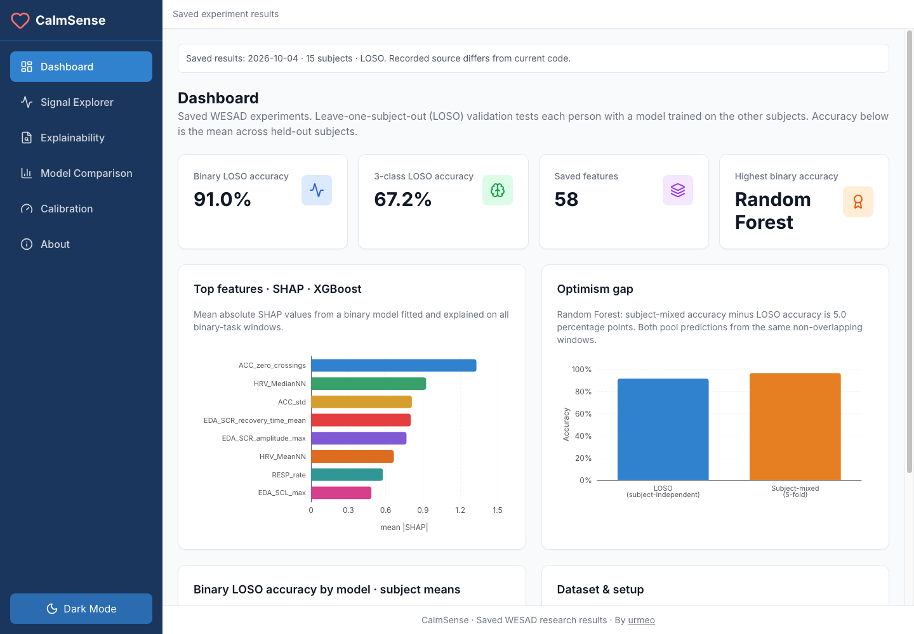</a>
</p>

The React dashboard displays saved research results and recorded signal excerpts. It does not run live inference.

## Images and videos

Select a preview to play or download the full video. Both recordings are silent.

**Dashboard tour · 32 s**

<p align="center">
<a href="https://urmeo.github.io/calm-sense/media/dashboard-tour.mp4">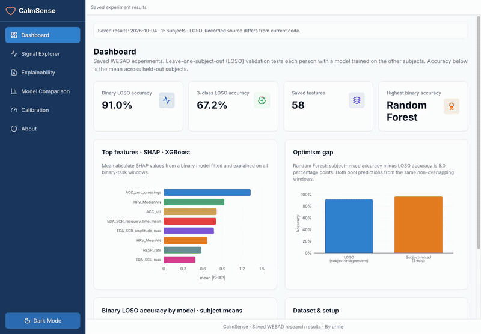</a>
</p>

Saved LOSO results, binary and three-class model comparison, calibration, and the research pipeline. [Watch video](https://urmeo.github.io/calm-sense/media/dashboard-tour.mp4) · [Repository copy](frontend/public/media/dashboard-tour.mp4)

**Signal exploration · 24 s**

<p align="center">
<a href="https://urmeo.github.io/calm-sense/media/signal-explorer.mp4">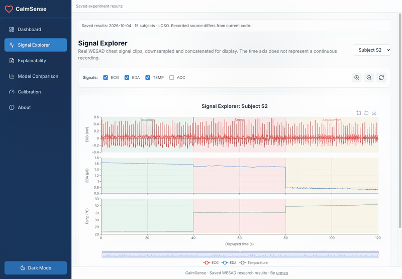</a>
</p>

Select a WESAD subject, toggle signal channels, zoom, and reset the view. [Watch video](https://urmeo.github.io/calm-sense/media/signal-explorer.mp4) · [Repository copy](frontend/public/media/signal-explorer.mp4)

<table width="100%">
<tr>
<td align="center" width="50%"><strong>Recorded chest signals</strong></td>
<td align="center" width="50%"><strong>Research pipeline</strong></td>
</tr>
<tr>
<td align="center"><a href="frontend/public/media/signal-explorer.png">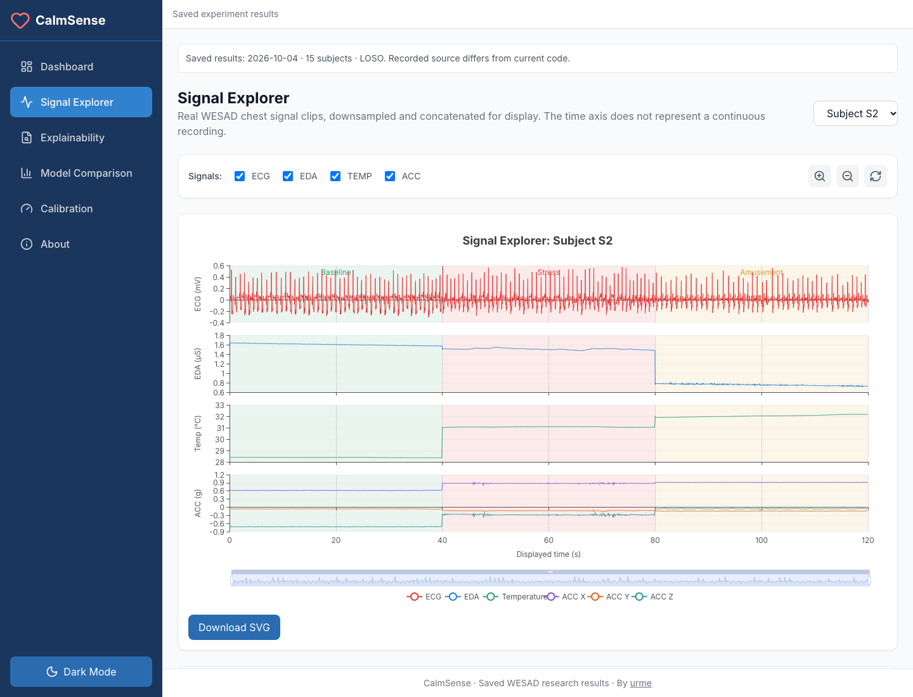</a></td>
<td align="center"><a href="frontend/public/media/research-pipeline.png">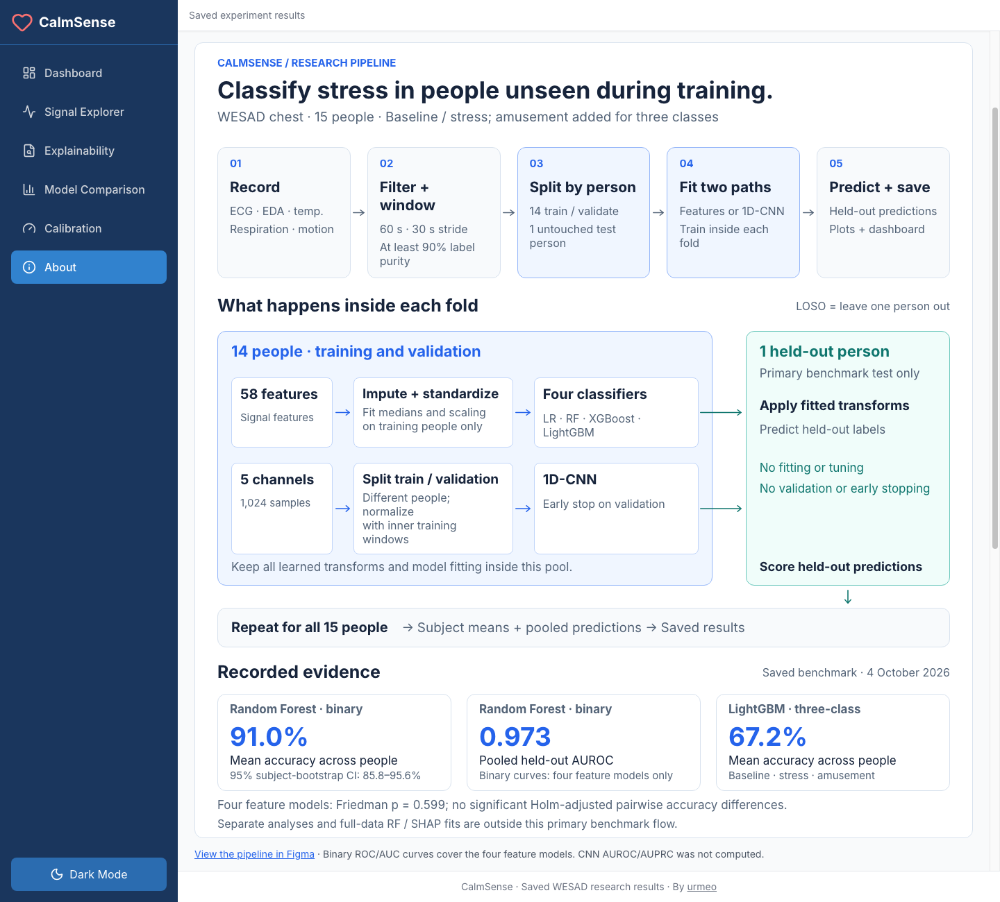</a></td>
</tr>
<tr>
<td>The clips are downsampled and concatenated for display. The time axis does not represent one continuous recording.</td>
<td>The feature and CNN paths have separate training rules. Each evaluation fold holds out one complete person.</td>
</tr>
</table>

<details>
<summary>Earlier dashboard preview</summary>


This preview predates the current screenshots and videos above.

</details>

## Recorded results

The [4 October 2026 benchmark](outputs/results/provenance.json) covers 15 WESAD subjects. The binary task separates baseline from stress; the three-class task adds amusement.

| Model | Binary accuracy | Binary macro-F1 | Binary AUROC | Binary AUPRC | Three-class accuracy | Three-class macro-F1 |
| :-- | --: | --: | --: | --: | --: | --: |
| Random Forest | 91.0% | 0.895 | 0.973 | 0.959 | 65.1% | 0.542 |
| XGBoost | 90.8% | 0.881 | 0.973 | 0.957 | 64.2% | 0.562 |
| Logistic Regression | 91.0% | 0.893 | 0.963 | 0.953 | 65.9% | 0.603 |
| LightGBM | 88.9% | 0.855 | 0.964 | 0.944 | 67.2% | 0.590 |
| 1D-CNN | 73.3% | 0.654 | Not computed | Not computed | 49.9% | 0.401 |

Accuracy and macro-F1 are means across subjects. AUROC and AUPRC use pooled held-out binary predictions. Random Forest has a pooled balanced accuracy of 89.9% and a subject-bootstrap 95% confidence interval of 85.8% to 95.6% for mean accuracy. The four feature models show no significant accuracy differences in the Friedman test (`p = 0.599`) or Holm-adjusted pairwise tests. [Metrics](outputs/results/metrics.json) and [statistics](outputs/results/stats.json) contain the recorded values.

## Graphs and charts

These are the original plots from the saved benchmark. Click a plot to open it at full size.

<table width="100%">
<tr>
<td align="center" width="50%"><strong>Binary accuracy · LOSO</strong></td>
<td align="center" width="50%"><strong>Three-class accuracy · LOSO</strong></td>
</tr>
<tr>
<td align="center" valign="middle" height="300" width="50%"><a href="outputs/figures/binary_model_comparison.png">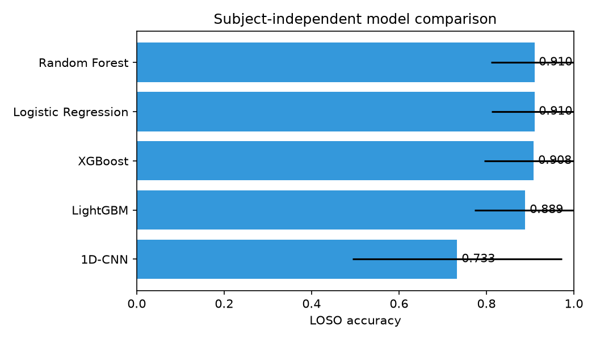</a></td>
<td align="center" valign="middle" height="300" width="50%"><a href="outputs/figures/multiclass_model_comparison.png">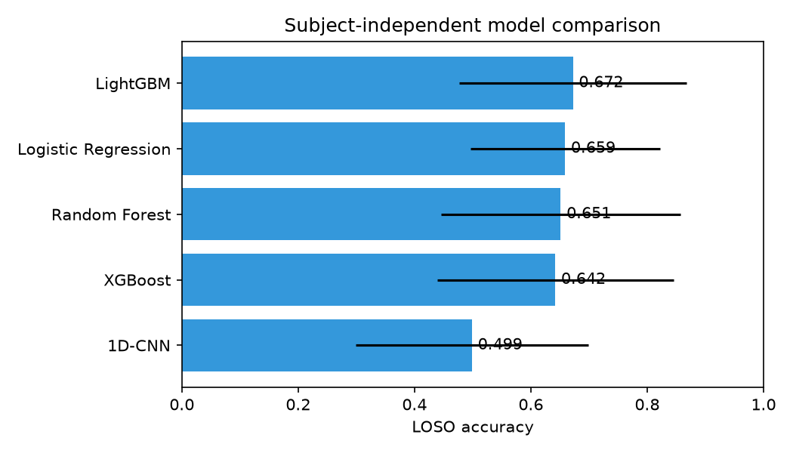</a></td>
</tr>
<tr>
<td align="center"><sub>RF <b>0.910</b> · five models</sub></td>
<td align="center"><sub>LightGBM <b>0.672</b> · five models</sub></td>
</tr>
<tr>
<td align="center" width="50%"><strong>Subject-mixed vs held-out testing</strong></td>
<td align="center" width="50%"><strong>Across the 15 subjects</strong></td>
</tr>
<tr>
<td align="center" valign="middle" height="300" width="50%"><a href="outputs/figures/binary_optimism_gap.png">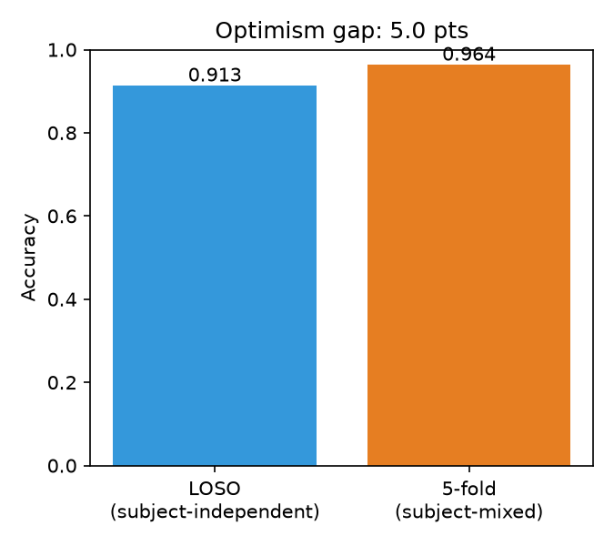</a></td>
<td align="center" valign="middle" height="300" width="50%"><a href="outputs/figures/binary_per_subject.png">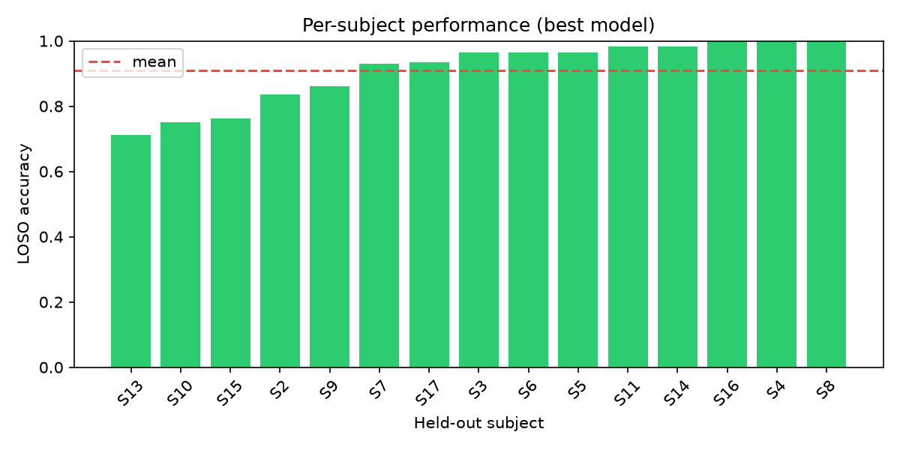</a></td>
</tr>
<tr>
<td align="center"><sub>Matched pooled accuracy: <b>0.913 → 0.964</b> · +5.0 pp</sub></td>
<td align="center"><sub><b>0.712 to 1.000</b> · RF accuracy</sub></td>
</tr>
<tr>
<td align="center" width="50%"><strong>Feature ablation</strong></td>
<td align="center" width="50%"><strong>Chest vs wrist</strong></td>
</tr>
<tr>
<td align="center" valign="middle" height="300" width="50%"><a href="outputs/figures/ablation.png">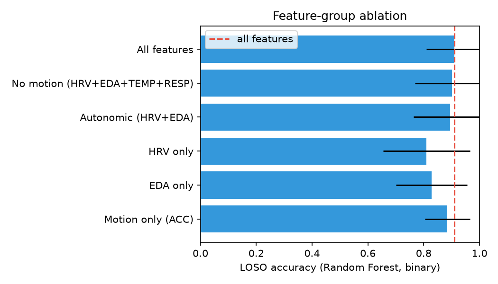</a></td>
<td align="center" valign="middle" height="300" width="50%"><a href="outputs/figures/chest_vs_wrist.png">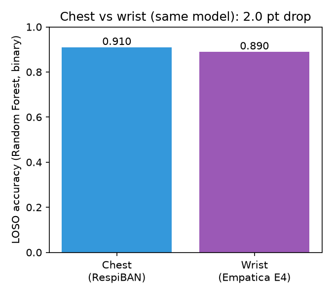</a></td>
</tr>
<tr>
<td align="center"><sub>RF: all <b>0.910</b> · no motion <b>0.901</b></sub></td>
<td align="center"><sub>RF: chest <b>0.910</b> · wrist <b>0.890</b></sub></td>
</tr>
<tr>
<td align="center" width="50%"><strong>Cross-dataset transfer</strong></td>
<td align="center" width="50%"><strong>SHAP explainability</strong></td>
</tr>
<tr>
<td align="center" valign="middle" height="300" width="50%"><a href="outputs/figures/cross_dataset.png">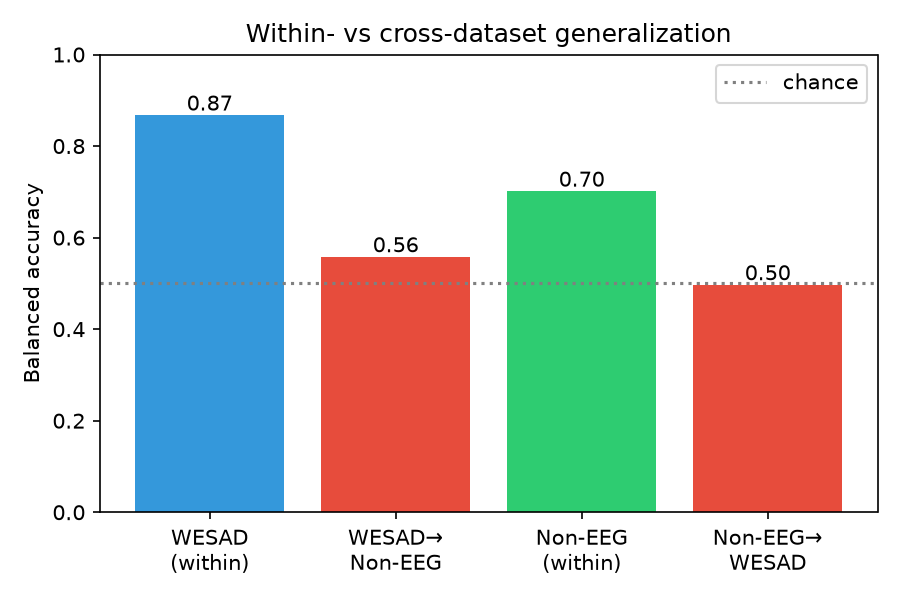</a></td>
<td align="center" valign="middle" height="300" width="50%"><a href="outputs/figures/shap_beeswarm.png">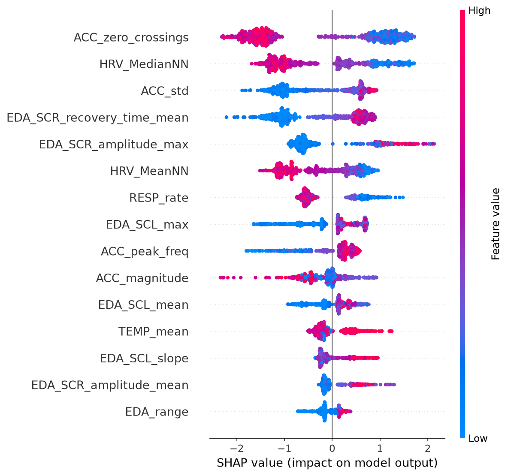</a></td>
</tr>
<tr>
<td align="center"><sub>Balanced accuracy: WESAD → Non-EEG <b>0.558</b> · reverse <b>0.497</b></sub></td>
<td align="center"><sub>XGBoost full-data fit · motion, HRV, EDA</sub></td>
</tr>
<tr>
<td align="center" width="50%"><strong>Probability calibration</strong></td>
<td align="center" width="50%"><strong>Few-shot personalization</strong></td>
</tr>
<tr>
<td align="center" valign="middle" height="300" width="50%"><a href="outputs/figures/calibration_reliability.png">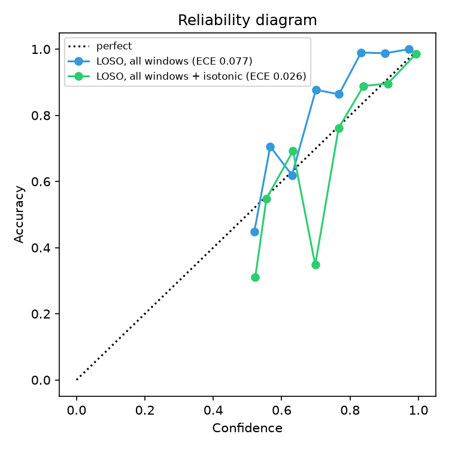</a></td>
<td align="center" valign="middle" height="300" width="50%"><a href="outputs/figures/personalization.png">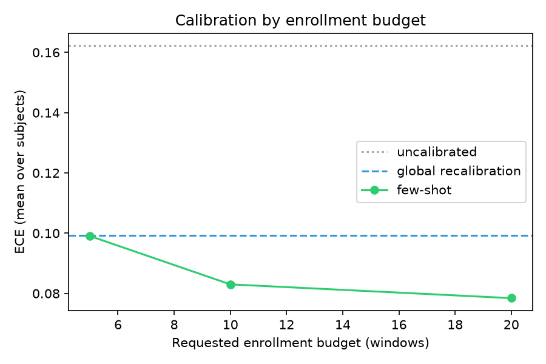</a></td>
</tr>
<tr>
<td align="center"><sub>RF pooled full-window LOSO ECE: <b>0.077 → 0.026</b></sub></td>
<td align="center"><sub>RF mean subject ECE: <b>0.162 → 0.078</b> · requested 20</sub></td>
</tr>
<tr>
<td align="center" width="50%"><strong>Binary confusion · RF</strong></td>
<td align="center" width="50%"><strong>Three-class confusion · LightGBM</strong></td>
</tr>
<tr>
<td align="center" valign="middle" height="300" width="50%"><a href="outputs/figures/binary_confusion.png">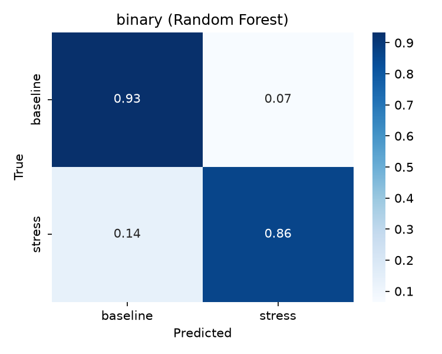</a></td>
<td align="center" valign="middle" height="300" width="50%"><a href="outputs/figures/multiclass_confusion.png">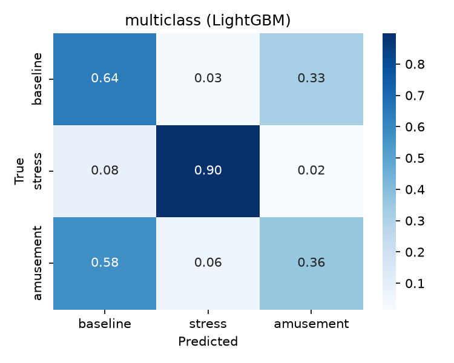</a></td>
</tr>
<tr>
<td align="center"><sub>Pooled default decisions</sub></td>
<td align="center"><sub>Pooled default decisions</sub></td>
</tr>
</table>

## ROC/AUC curves


ROC curves show the true-positive and false-positive rates as the stress-probability threshold changes. AUROC summarizes the curve. These scores pool held-out binary predictions; the accuracy and macro-F1 values above are subject means. The [curve replay](outputs/results/roc_curves.json) uses the original benchmark code and verified cached inputs. All four AUROC and AUPRC values match the saved scores exactly. No CNN AUROC or AUPRC was recorded.

## Calibration and personalization

<p align="center">
<a href="outputs/figures/calibration_decision_curve.png">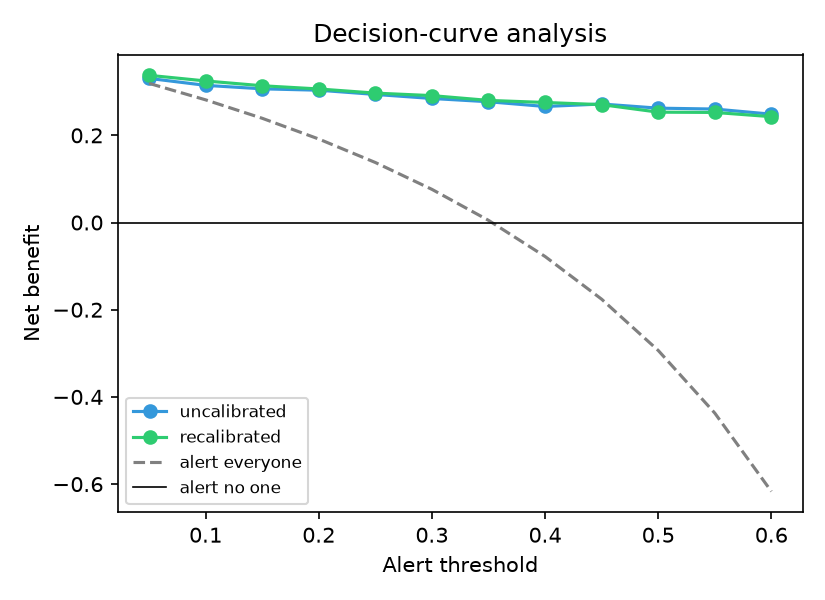</a>
</p>

The decision curve shows net benefit across probability thresholds. It is an exploratory analysis and does not establish a clinical alert threshold.

<details>
<summary>Calibration and personalization results</summary>

Calibration uses Random Forest predictions, 15 confidence bins, and an isotonic calibrator fitted to out-of-fold predictions from training subjects. ECE is the weighted mean absolute gap between confidence and accuracy; MCE is the largest absolute bin gap. Brier is the mean squared error of the stress probability. Lower values indicate less error.

<!-- AUTOGEN:calibration START -->
| Evaluation | ECE | MCE | Brier |
| --- | :-: | :-: | :-: |
| Subject-mixed 5-fold, non-overlapping | 0.087 | 0.252 | 0.038 |
| LOSO, matched non-overlapping | 0.090 | 0.363 | 0.073 |
| LOSO, all windows | 0.077 | 0.177 | 0.069 |
| LOSO, all windows + isotonic | 0.026 | 0.350 | 0.064 |
<!-- AUTOGEN:calibration END -->

These are pooled metrics. The matched rows use the same non-overlapping subset. Personalization below reports subject means on a reserved evaluation half of each subject's non-overlapping windows. Labeled enrollment windows are separate from evaluation windows; the classifier is not retrained.

<!-- AUTOGEN:personalization START -->
| Recalibration / requested enrollment budget | ECE | Brier |
| --- | :-: | :-: |
| None (LOSO) | 0.162 | 0.073 |
| Global (training subjects) | 0.099 | 0.071 |
| Per-subject, budget 5 | 0.099 | 0.061 |
| Per-subject, budget 10 | 0.083 | 0.061 |
| Per-subject, budget 20 | 0.078 | 0.063 |
<!-- AUTOGEN:personalization END -->

A budget of 5 selects 4 class-balanced enrollment windows. Limited class availability can also reduce larger requests. See [methodology](docs/methodology.md#calibration-and-personalization) for evaluation details.

</details>

[All saved charts and tables](outputs/README.md) · [Detailed evaluation conditions](docs/methodology.md)

## Run locally

Use Node.js 24 and npm. The dashboard reads saved results; no Python environment or dataset download is needed.

```bash
git clone https://github.com/urmeo/calm-sense.git
cd calm-sense
node frontend/tooling.mjs install
node frontend/tooling.mjs dev
```

Open [http://127.0.0.1:5173/calm-sense/](http://127.0.0.1:5173/calm-sense/).

For Python setup, a synthetic demo, and the full benchmark, see the [reproduction guide](docs/reproduction.md). See [CONTRIBUTING.md](CONTRIBUTING.md) for code checks.

## References

1. Schmidt et al. (2018). [Introducing WESAD, a Multimodal Dataset for Wearable Stress and Affect Detection](https://doi.org/10.1145/3242969.3242985). *ACM ICMI*, 400-408.
2. ESC/NASPE Task Force (1996). [Heart Rate Variability: Standards of Measurement, Physiological Interpretation, and Clinical Use](https://doi.org/10.1161/01.CIR.93.5.1043). *Circulation*, 93(5), 1043-1065.
3. Guo et al. (2017). [On Calibration of Modern Neural Networks](https://proceedings.mlr.press/v70/guo17a.html). *ICML*, PMLR 70, 1321-1330.
4. Vos et al. (2023). [Generalizable Machine Learning for Stress Monitoring from Wearable Devices: A Systematic Literature Review](https://doi.org/10.1016/j.ijmedinf.2023.105026). *International Journal of Medical Informatics*, 173, 105026.
