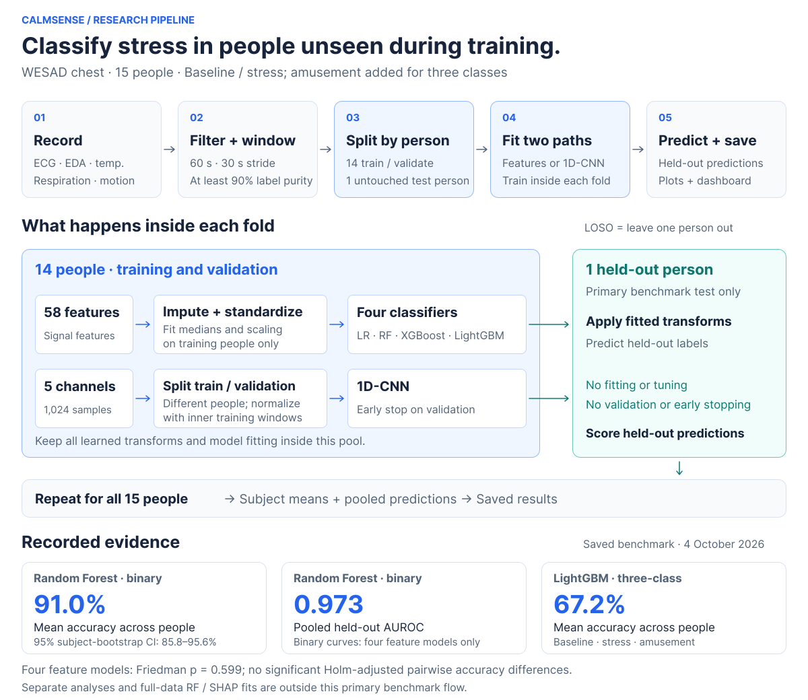
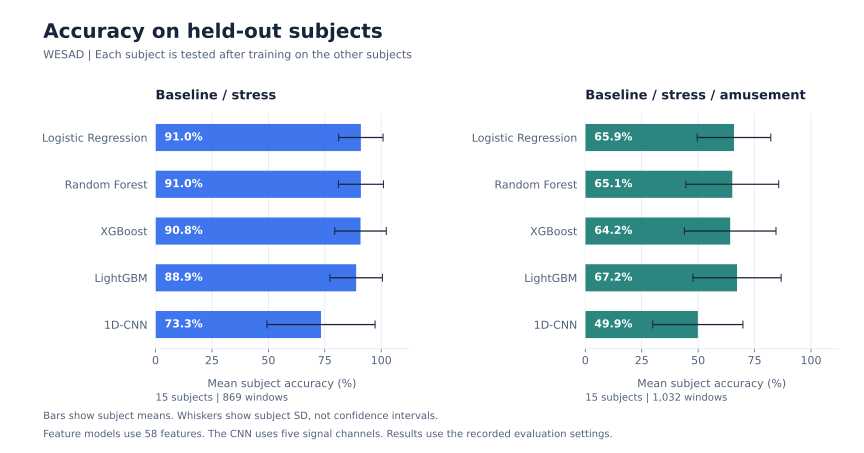
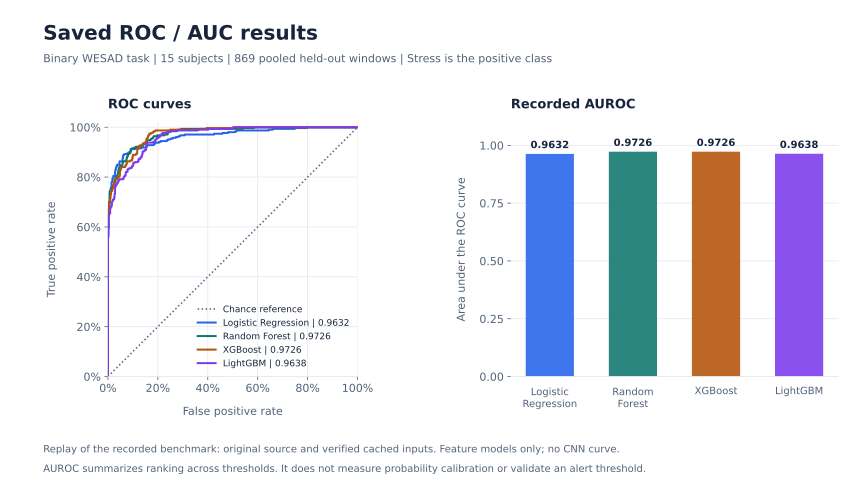
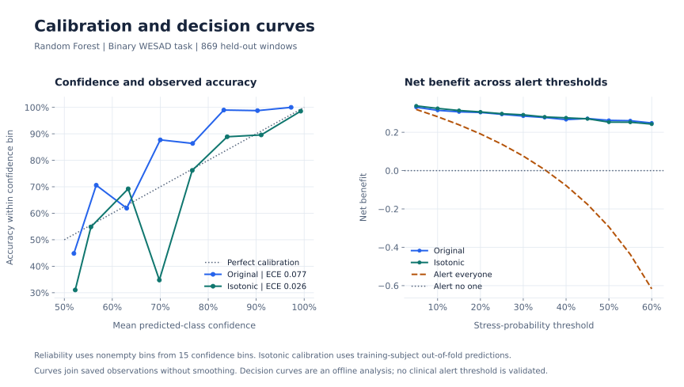

# CalmSense

CalmSense classifies stress from wearable physiological recordings. It compares four feature-based classifiers and a 1D convolutional neural network on WESAD, then examines calibration, personalization, chest and wrist signals, and transfer to a second dataset.

The dashboard displays saved research results and recorded signal excerpts. It does not run live inference.

[Results dashboard](https://urmeo.github.io/calm-sense/) · [Colab demo](https://colab.research.google.com/github/urmeo/calm-sense/blob/main/notebooks/CalmSense.ipynb) · [Repository map](docs/structure.md) · [Methodology](docs/methodology.md) · [Reproduction](docs/reproduction.md)

## Data flow



The recorded chest benchmark uses 58 features for Random Forest, XGBoost, Logistic Regression, and LightGBM. The CNN uses five processed signal channels. The feature registry has 60 entries; two respiration features are entirely missing in this benchmark.

Python, NumPy, pandas, SciPy, and NeuroKit2 handle signals and features. Models use scikit-learn, XGBoost, LightGBM, and PyTorch; SHAP describes a separate full-data XGBoost fit. The dashboard uses React and TypeScript.

## Recorded results

The [4 October 2026 benchmark](outputs/results/provenance.json) tests 15 WESAD subjects with leave-one-subject-out (LOSO) evaluation. Each fold trains on 14 subjects and tests on the remaining one. The binary task separates baseline from stress; the three-class task adds amusement.



<details>
<summary>Exact model scores and statistical comparison</summary>

| Model | Binary accuracy | Binary macro-F1 | Binary AUROC | Binary AUPRC | Three-class accuracy | Three-class macro-F1 |
| :-- | --: | --: | --: | --: | --: | --: |
| Random Forest | 91.0% | 0.895 | 0.973 | 0.959 | 65.1% | 0.542 |
| XGBoost | 90.8% | 0.881 | 0.973 | 0.957 | 64.2% | 0.562 |
| Logistic Regression | 91.0% | 0.893 | 0.963 | 0.953 | 65.9% | 0.603 |
| LightGBM | 88.9% | 0.855 | 0.964 | 0.944 | 67.2% | 0.590 |
| 1D-CNN | 73.3% | 0.654 | Not computed | Not computed | 49.9% | 0.401 |

Accuracy and macro-F1 are means across subjects. AUROC and AUPRC use pooled held-out binary predictions. Random Forest has a pooled balanced accuracy of 89.9% and a subject-bootstrap 95% confidence interval of 85.8% to 95.6% for mean accuracy. The four feature models show no significant accuracy differences in the Friedman test (`p = 0.599`) or Holm-adjusted pairwise tests. [Metrics](outputs/results/metrics.json) and [statistics](outputs/results/stats.json) contain the recorded values.

</details>



ROC curves compare the true-positive rate with the false-positive rate as the stress-probability threshold changes. AUROC summarizes that curve. These binary scores pool held-out predictions; they are separate from the subject means above. The [curve replay](outputs/results/roc_curves.json) uses the original benchmark code and verified cached inputs; all four AUROC and AUPRC values match the saved scores exactly. The CNN has no recorded AUROC or AUPRC result.



<details>
<summary>Calibration and personalization results</summary>

Calibration uses Random Forest predictions, 15 confidence bins, and an isotonic calibrator fitted to out-of-fold predictions from training subjects. ECE is the weighted mean absolute gap between confidence and accuracy; MCE is the largest absolute bin gap. Brier is the mean squared error of the stress probability. Lower values indicate less error.

<!-- AUTOGEN:calibration START -->
| Evaluation | ECE | MCE | Brier |
| --- | :-: | :-: | :-: |
| Subject-mixed 5-fold, non-overlapping | 0.087 | 0.252 | 0.038 |
| LOSO, matched non-overlapping | 0.090 | 0.363 | 0.073 |
| LOSO, all windows | 0.077 | 0.177 | 0.069 |
| LOSO, all windows + isotonic | 0.026 | 0.350 | 0.064 |
<!-- AUTOGEN:calibration END -->

These are pooled metrics. The matched rows use the same non-overlapping subset. Personalization below reports subject means on a reserved evaluation half of each subject's non-overlapping windows. Labeled enrollment windows are separate from evaluation windows; the classifier is not retrained.

<!-- AUTOGEN:personalization START -->
| Recalibration / requested enrollment budget | ECE | Brier |
| --- | :-: | :-: |
| None (LOSO) | 0.162 | 0.073 |
| Global (training subjects) | 0.099 | 0.071 |
| Per-subject, budget 5 | 0.099 | 0.061 |
| Per-subject, budget 10 | 0.083 | 0.061 |
| Per-subject, budget 20 | 0.078 | 0.063 |
<!-- AUTOGEN:personalization END -->

A budget of 5 selects 4 class-balanced enrollment windows. Limited class availability can also reduce larger requests. See [methodology](docs/methodology.md#calibration-and-personalization) for evaluation details.

</details>

[Transfer chart](docs/assets/transfer.svg) · [All saved charts and tables](outputs/README.md)

## Run locally

Use Python 3.11 or later. On macOS, install the OpenMP library for XGBoost and LightGBM with `brew install libomp`.

```bash
git clone https://github.com/urmeo/calm-sense.git
cd calm-sense
python3 -m venv .venv
source .venv/bin/activate
python -m pip install -r requirements.txt
```

Run a calibration example without downloading datasets:

```bash
python scripts/calibration.py --synthetic
```

This writes demo metrics and figures to `outputs/generated/demo/`. Synthetic results check the pipeline; they do not reproduce the WESAD benchmark. The [notebook](notebooks/CalmSense.ipynb) runs the same example in Colab.

To run the WESAD benchmark, review the dataset's research agreement, then download and verify its subject files:

```bash
python scripts/download_data.py --wesad
python scripts/download_data.py --verify-wesad
python scripts/run_experiment.py
```

You can also place the official files at `data/raw/WESAD/S2/S2.pkl`, and so on, before verification. Raw datasets are not included. Real-data experiments replace files in `outputs/results/` and `outputs/models/`. See the [reproduction guide](docs/reproduction.md) for analysis commands, storage requirements, and dashboard exports.

The dashboard can run on its saved exports without Python or raw data. Use Node.js 24 and npm:

```bash
node frontend/tooling.mjs install
node frontend/tooling.mjs dev
```

Open [the local dashboard](http://127.0.0.1:5173/calm-sense/). To check the Python code and build the dashboard:

```bash
python -m unittest discover -s tests
node frontend/tooling.mjs test
node frontend/tooling.mjs build
```

Regenerate the documentation charts from saved results, without training models:

```bash
python -m scripts.plot_results
```

See the [reproduction guide](docs/reproduction.md) for ROC curve generation and the commands for secondary analyses.

## Protocol & provenance

The saved results record source revision `4f5c02f`, seed `42`, feature schema and benchmark protocol version `2`, and portable feature schema version `3`. The [provenance record](outputs/results/provenance.json) contains package versions, dataset checksums, and artifact hashes. These describe the saved run; code changes require a new run to measure their effect.

The [saved model](outputs/models/stress_classifier.joblib) is an uncalibrated chest Random Forest refitted on all 869 binary windows and 58 features with scikit-learn 1.6.1. Load it from a trusted checkout with `load_verified_joblib` in [src/utils.py](src/utils.py). Its full-data fit is separate from held-out evaluation. Tuning results do not change this model's defaults.

## Limitations

- WESAD contains 15 laboratory subjects. These results do not establish performance in daily life or clinical settings.
- Sixty-second windows limit the interpretation of very-low-frequency HRV and long-term detrended fluctuation analysis. Ablation, calibration, and personalization are exploratory analyses without multiplicity correction; pairwise model tests use Holm correction.
- Transfer is measured on one dataset pair with different devices, units, stressors, and labels. Balanced accuracy is 0.558 from WESAD to Non-EEG and 0.497 in reverse. [Transfer details](docs/methodology.md#cross-dataset-transfer) explain the label mapping and unit differences.
- Live inference latency and wearable battery use have not been measured. Decision curves do not establish a clinical alert threshold.

Use physiological recordings with informed consent, limit collection to required signals, and follow each dataset's terms. The project is for research use.

## References

1. Schmidt et al. (2018). [Introducing WESAD, a Multimodal Dataset for Wearable Stress and Affect Detection](https://doi.org/10.1145/3242969.3242985). *ACM ICMI*, 400-408.
2. ESC/NASPE Task Force (1996). [Heart Rate Variability: Standards of Measurement, Physiological Interpretation, and Clinical Use](https://doi.org/10.1161/01.CIR.93.5.1043). *Circulation*, 93(5), 1043-1065.
3. Guo et al. (2017). [On Calibration of Modern Neural Networks](https://proceedings.mlr.press/v70/guo17a.html). *ICML*, PMLR 70, 1321-1330.
4. Vos et al. (2023). [Generalizable Machine Learning for Stress Monitoring from Wearable Devices: A Systematic Literature Review](https://doi.org/10.1016/j.ijmedinf.2023.105026). *International Journal of Medical Informatics*, 173, 105026.

## Author and license

[urmeo](https://github.com/urmeo) is the sole contributor and maintainer. The code is licensed under [MIT](LICENSE); dataset terms apply separately. See [CONTRIBUTING.md](CONTRIBUTING.md) for development checks and [CITATION.cff](CITATION.cff) for citation metadata.
