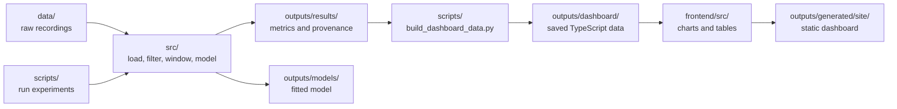

# Repository map

```text
calm-sense/
├── README.md                 Start here: pipeline, results, local setup
├── docs/
│   ├── assets/               Pipeline diagrams and result summary charts
│   ├── methodology.md        Evaluation conditions and limitations
│   ├── reproduction.md       Dataset, experiment, and build commands
│   └── structure.md          This map
├── src/                      Reusable Python code
│   ├── data/                 WESAD recording loader
│   ├── datasets/             Non-EEG dataset and record readers
│   ├── preprocessing/        Filters, ECG processing, EDA processing
│   ├── features/             HRV, EDA, temperature, respiration, motion
│   ├── models/
│   │   ├── ml/               Four feature-based classifiers
│   │   └── dl/               1D convolutional neural network
│   ├── dataset.py            Chest windows and feature cache
│   ├── dataset_wrist.py      Wrist windows and feature cache
│   ├── portable.py           Shared features for dataset transfer
│   ├── calibration.py        Calibration and enrollment routines
│   ├── synthetic.py          Generated inputs for pipeline checks
│   └── config.py             Paths, signal rates, window settings, seed
├── scripts/                  Experiment, chart, and export commands
├── tests/                    Python tests and documentation checks
├── notebooks/
│   └── CalmSense.ipynb       Synthetic calibration example for Colab
├── frontend/
│   ├── config/               Tracked dependency and build settings
│   ├── public/               Browser icons and static files
│   ├── src/
│   │   ├── components/       Shared charts, panels, cards, and layout
│   │   │   └── layout/       Header and sidebar
│   │   ├── lib/              Chart, signal, and navigation helpers
│   │   ├── pages/            Six dashboard pages
│   │   └── types/            Shared TypeScript definitions
│   ├── tests/                Dashboard data and behavior checks
│   ├── tooling.mjs           Install, test, dev, build, preview commands
│   └── build.mjs             Browser bundle and local server
├── outputs/
│   ├── README.md             Saved results and chart index
│   ├── results/              Recorded CSV/JSON metrics and provenance
│   ├── figures/              Recorded plot snapshots and dashboard GIF
│   ├── models/               Recorded model and SHA-256 checksum
│   ├── dashboard/            Saved results and signal exports
│   └── generated/            Ignored local files created by commands
│       ├── cache/            Processed features
│       ├── demo/             Synthetic results, figures, and models
│       ├── figures/          Plots from real-data reruns
│       ├── logs/             Experiment logs
│       └── site/             Built dashboard
├── data/                     Ignored local datasets; created on download
│   ├── raw/WESAD/            WESAD subject recordings
│   └── external/noneeg/      PhysioNet Non-EEG recordings
└── .github/workflows/        Dashboard deployment
```

Local folders appear as commands create them. `.venv/`, `frontend/node_modules/`, frontend JSON settings, caches, raw data, and `outputs/generated/` are ignored by Git.

## Follow the files



| Work | Location |
| :-- | :-- |
| Read the evaluation protocol | [methodology.md](methodology.md) |
| Run or reproduce an experiment | [reproduction.md](reproduction.md) and [scripts/](../scripts/) |
| Change signal processing or models | [src/](../src/) |
| Change a dashboard page | [frontend/src/pages/](../frontend/src/pages/) |
| Change dashboard dependencies | [frontend/config/package.mjs](../frontend/config/package.mjs) |
| Find saved charts, tables, and model files | [outputs/README.md](../outputs/README.md) |
| Regenerate documentation charts | [scripts/plot_results.py](../scripts/plot_results.py) |
| Check a change | [CONTRIBUTING.md](../CONTRIBUTING.md) |

Keep reusable calculations in `src/`, command entry points in `scripts/`, documentation visuals in `docs/assets/`, and local build files in `outputs/generated/`. Saved research files retain their paths because the provenance record and dashboard exporter reference them. Real-data experiment commands can replace files in `outputs/results/` and `outputs/models/`; the [reproduction guide](reproduction.md#primary-benchmark) explains this behavior.
